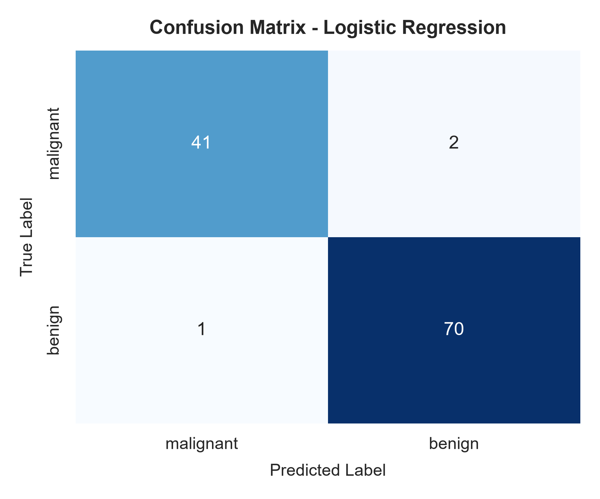
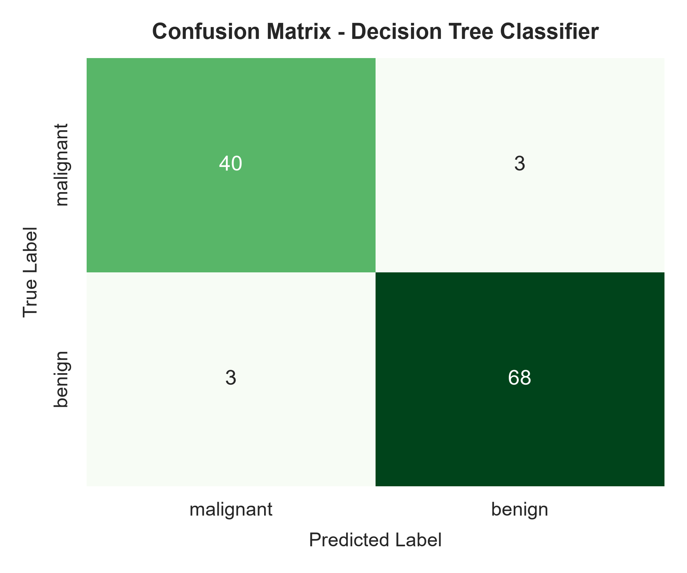
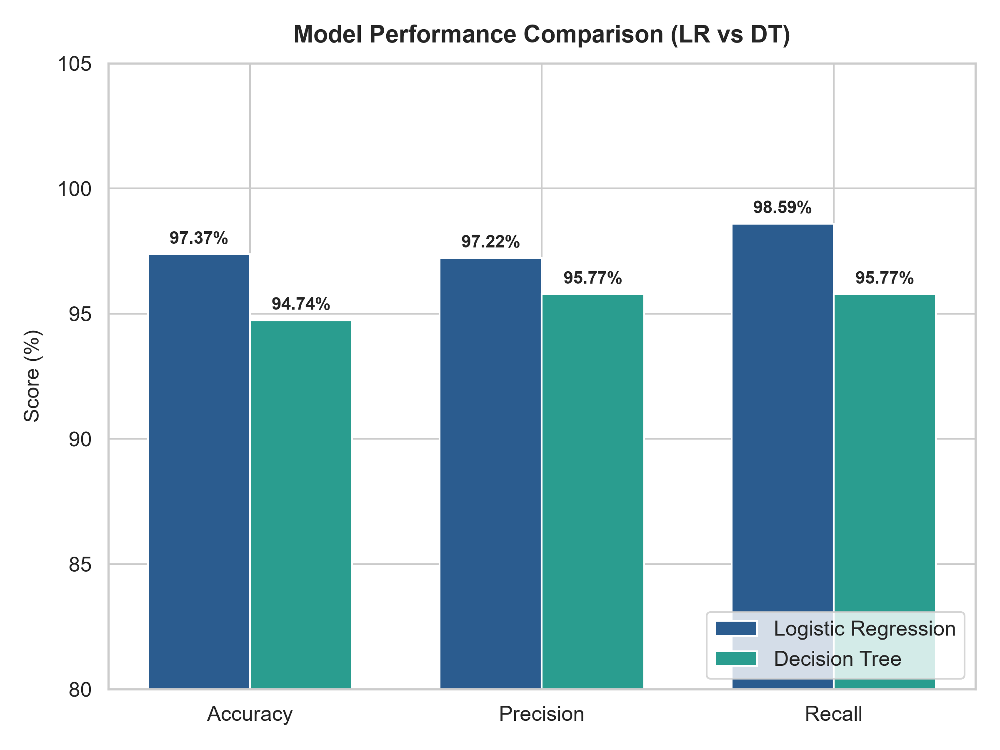

# Simple Classification Model Build Using Machine Learning

[](https://colab.research.google.com/github/Dhinesh8023/Simple-Classification-Model/blob/main/classification_model.ipynb)
[](https://www.python.org/)
[](https://scikit-learn.org/)
[](https://jupyter.org/)
[](https://opensource.org/licenses/MIT)

An end-to-end, beginner-friendly Machine Learning classification project implementing **Logistic Regression** and **Decision Tree Classifier** on the **Breast Cancer Wisconsin (Diagnostic) Dataset**. This repository includes complete data preprocessing, exploratory data analysis, feature scaling, model training, performance evaluation across multiple metrics, visualizations, and an interactive Google Colab notebook ready for academic submission.

---

## Table of Contents
- [Project Overview](#project-overview)
- [Problem Statement](#problem-statement)
- [Objectives](#objectives)
- [Dataset Details](#dataset-details)
- [Technologies & Libraries Used](#technologies--libraries-used)
- [Machine Learning Algorithms](#machine-learning-algorithms)
  - [1. Logistic Regression](#1-logistic-regression)
  - [2. Decision Tree Classifier](#2-decision-tree-classifier)
- [Data Preprocessing Pipeline](#data-preprocessing-pipeline)
- [Evaluation Metrics & Definitions](#evaluation-metrics--definitions)
- [Actual Model Performance Results](#actual-model-performance-results)
  - [Performance Comparison Table](#performance-comparison-table)
  - [Detailed Classification Reports](#detailed-classification-reports)
- [Visualizations](#visualizations)
  - [Confusion Matrix Heatmaps](#confusion-matrix-heatmaps)
  - [Model Performance Comparison Chart](#model-performance-comparison-chart)
- [Results and Discussion](#results-and-discussion)
- [How to Run the Project](#how-to-run-the-project)
  - [Option A: Google Colab (One-Click)](#option-a-google-colab-one-click)
  - [Option B: Local Setup with Python](#option-b-local-setup-with-python)
- [Repository Structure](#repository-structure)
- [Limitations & Future Scope](#limitations--future-scope)
- [Conclusion](#conclusion)
- [Author & Acknowledgments](#author--acknowledgments)

---

## Project Overview

Supervised classification algorithms enable automated diagnostic decision-making by identifying patterns in multidimensional biometric measurements. This project demonstrates the practical application of supervised learning to differentiate between **benign** (non-cancerous) and **malignant** (cancerous) breast tissue biopsies using digitized morphometric features.

Both models are evaluated on a held-out test set ($N=114$, 20% of data) using:
- **Accuracy**
- **Precision**
- **Recall**
- **Confusion Matrix**
- **Classification Report**

---

## Problem Statement

Breast cancer is among the leading causes of cancer-related mortality worldwide. Early and precise diagnosis significantly improves survival rates and prevents invasive, unnecessary surgical procedures. Clinical examination of biopsy samples can be prone to human subjective variability. 

The objective of this project is to build and evaluate robust, reproducible machine learning classifiers that predict tumor malignancy from quantitative cell nucleus characteristics extracted from Fine Needle Aspirate (FNA) biopsy samples.

---

## Objectives

1. Load and inspect the Breast Cancer Wisconsin Diagnostic dataset using Scikit-learn.
2. Perform Exploratory Data Analysis (EDA) to verify data integrity, data types, and class balance.
3. Implement a data preprocessing pipeline:
   - Feature-target separation
   - 80/20 train-test split (`random_state=42`)
   - Feature standardization using `StandardScaler`
4. Train two classification algorithms:
   - **Logistic Regression** (linear, parametric probabilistic classifier)
   - **Decision Tree Classifier** (non-linear, non-parametric hierarchical classifier)
5. Compute and compare evaluation metrics: Accuracy, Precision, Recall, and Confusion Matrices.
6. Generate visualizations (Confusion Matrix heatmaps and metric comparison bar charts).
7. Analyze clinical trade-offs (e.g., minimizing False Negatives in medical diagnosis) and synthesize findings into an academic-grade report.

---

## Dataset Details

The **Breast Cancer Wisconsin (Diagnostic) Dataset** is a classic benchmark dataset in biomedical computing, collected by Dr. William H. Wolberg, W. Nick Street, and Olvi L. Mangasarian at the University of Wisconsin Hospitals, Madison.

| Attribute | Specification |
| :--- | :--- |
| **Source** | Scikit-learn (`sklearn.datasets.load_breast_cancer`) |
| **Number of Instances** | 569 patient biopsy samples |
| **Number of Features** | 30 continuous real-valued numeric attributes |
| **Target Variable** | Binary Diagnosis: `0 = Malignant` (harmful), `1 = Benign` (non-harmful) |
| **Class Distribution** | Benign: 357 (62.74%), Malignant: 212 (37.26%) |
| **Missing Values** | 0 (None) |

### Ten Core Nuclear Characteristics Computed:
1. **Radius:** Mean of distances from center to points on perimeter
2. **Texture:** Standard deviation of gray-scale values
3. **Perimeter:** Total boundary distance
4. **Area:** Total interior surface area
5. **Smoothness:** Local variation in radius lengths
6. **Compactness:** $\frac{\text{Perimeter}^2}{\text{Area}} - 1.0$
7. **Concavity:** Severity of concave portions of the contour
8. **Concave Points:** Number of concave portions of the contour
9. **Symmetry:** Nuclear symmetry index
10. **Fractal Dimension:** "Coastline approximation" $- 1$

For each cell nucleus, the **mean**, **standard error (SE)**, and **"worst"** (mean of the three largest values) were computed, resulting in $10 \times 3 = 30$ features.

---

## Technologies & Libraries Used

- **Python (v3.8+)**: Core programming language.
- **Scikit-learn (v1.2+)**: Machine learning algorithms, dataset loader, scaling, and evaluation metrics.
- **Pandas (v2.0+)**: Data structuring, exploration, and tabular reporting.
- **NumPy (v1.24+)**: Vectorized numerical array computations.
- **Matplotlib (v3.7+) & Seaborn (v0.12+)**: Static publication-grade visualizations.
- **Google Colab & Jupyter Notebook**: Interactive computing and documentation.

---

## Machine Learning Algorithms

### 1. Logistic Regression
- **Mathematical Form:** $P(y=1|X) = \sigma(w^T X + b) = \frac{1}{1 + e^{-(w^T X + b)}}$
- **Paradigm:** Parametric, linear classifier with logistic (sigmoid) activation.
- **Why Used:** Provides calibrated probability estimates, resists overfitting on small feature spaces when regularized ($L_2$ penalty), and converges rapidly on linearly separable continuous features.
- **Configuration:** `max_iter=1000`, `random_state=42`.

### 2. Decision Tree Classifier
- **Splitting Criterion:** Gini Impurity: $\text{Gini}(D) = 1 - \sum_{k=1}^C p_k^2$
- **Paradigm:** Non-parametric, rule-based hierarchical classifier.
- **Why Used:** Generates intuitive, human-interpretable orthogonal decision rules without requiring feature scaling or linear distribution assumptions.
- **Configuration:** `max_depth=4` (to prevent overfitting), `random_state=42`.

### Comparison of Algorithmic Approaches
| Characteristic | Logistic Regression | Decision Tree Classifier |
| :--- | :--- | :--- |
| **Model Type** | Parametric, linear | Non-parametric, non-linear |
| **Decision Boundary** | Continuous linear hyperplane | Orthogonal, axis-aligned step boundaries |
| **Feature Scale Sensitivity** | Highly sensitive (requires `StandardScaler`) | Invariant to monotonic feature scaling |
| **Interpretability** | Feature weight coefficients / log-odds | Tree flowchart with explicit IF-THEN rules |
| **Overfitting Risk** | Low when regularized | High on small datasets without depth limits |

---

## Data Preprocessing Pipeline

```
Raw Dataset (569 samples, 30 features)
                     │
                     ▼
  Check Missing Values & Validate Types (0 nulls)
                     │
                     ▼
  Separate Features (X) & Target Diagnosis (y)
                     │
                     ▼
  80% Train / 20% Test Split (random_state=42)
  ├── Training Set: 455 samples
  └── Testing Set:  114 samples
                     │
                     ▼
  Feature Scaling via StandardScaler
  - Fit on X_train only (prevents data leakage)
  - Transform X_train & X_test (z = (x - μ) / σ)
```

---

## Evaluation Metrics & Definitions

- **Accuracy:** The proportion of total correct predictions (both benign and malignant) among all tested samples:
  $$\text{Accuracy} = \frac{TP + TN}{TP + TN + FP + FN}$$
- **Precision:** The proportion of predicted positive cases that were genuinely positive. Indicates how trustworthy a positive diagnostic call is:
  $$\text{Precision} = \frac{TP}{TP + FP}$$
- **Recall (Sensitivity):** The proportion of actual positive cases correctly identified by the model. Critical in healthcare to avoid missing positive patients:
  $$\text{Recall} = \frac{TP}{TP + FN}$$
- **Confusion Matrix:** A $2 \times 2$ contingency table mapping true disease status against model diagnostic calls:
  - **True Negative (TN):** Malignant correctly diagnosed as Malignant.
  - **False Positive (FP):** Malignant incorrectly diagnosed as Benign.
  - **False Negative (FN):** Benign incorrectly diagnosed as Malignant.
  - **True Positive (TP):** Benign correctly diagnosed as Benign.

---

## Actual Model Performance Results

All models were evaluated on the exact same 114 test samples using `random_state=42`.

### Performance Comparison Table

| Metric | Logistic Regression | Decision Tree Classifier | Winner |
| :--- | :---: | :---: | :---: |
| **Accuracy** | **97.37%** (0.9737) | **94.74%** (0.9474) | **Logistic Regression (+2.63%)** |
| **Precision** | **97.22%** (0.9722) | **95.77%** (0.9577) | **Logistic Regression (+1.45%)** |
| **Recall** | **98.59%** (0.9859) | **95.77%** (0.9577) | **Logistic Regression (+2.82%)** |

---

### Detailed Classification Reports

#### Model 1: Logistic Regression
```
              precision    recall  f1-score   support

   malignant       0.98      0.95      0.96        43
      benign       0.97      0.99      0.98        71

    accuracy                           0.97       114
   macro avg       0.97      0.97      0.97       114
weighted avg       0.97      0.97      0.97       114
```
- **Confusion Matrix:**
  $$\begin{bmatrix} 41 & 2 \\ 1 & 70 \end{bmatrix}$$
  - Correct predictions: $41 + 70 = 111$ out of 114
  - Errors: Only 3 misclassifications ($2.63\%$)

#### Model 2: Decision Tree Classifier (`max_depth=4`)
```
              precision    recall  f1-score   support

   malignant       0.93      0.93      0.93        43
      benign       0.96      0.96      0.96        71

    accuracy                           0.95       114
   macro avg       0.94      0.94      0.94       114
weighted avg       0.95      0.95      0.95       114
```
- **Confusion Matrix:**
  $$\begin{bmatrix} 40 & 3 \\ 3 & 68 \end{bmatrix}$$
  - Correct predictions: $40 + 68 = 108$ out of 114
  - Errors: 6 misclassifications ($5.26\%$)

---

## Visualizations

### Confusion Matrix Heatmaps

| Logistic Regression | Decision Tree Classifier |
| :---: | :---: |
|  |  |

### Model Performance Comparison Chart

The bar chart below summarizes the superior performance of Logistic Regression across Accuracy, Precision, and Recall:



---

## Results and Discussion

### 1. Which Model Performed Better?
**Logistic Regression** achieved superior performance across all evaluation metrics, reaching **97.37% Accuracy** and **98.59% Recall**, compared to **94.74% Accuracy** and **95.77% Recall** for the Decision Tree.

### 2. Why Did Logistic Regression Outperform the Decision Tree?
- **Linear Separability:** In high-dimensional standardized space, morphometric features of cell nuclei (such as radius, area, and concavity) correlate smoothly and monotonically with malignancy, forming a clear hyperplanar boundary.
- **Reduced Variance:** Decision trees construct step-like, axis-aligned boundaries. With 30 features and relatively modest sample sizes ($N=455$ training rows), individual splits are vulnerable to variance and slight boundary noise.
- **Regularization Advantage:** Scikit-Learn's built-in $L_2$ regularization in `LogisticRegression` shrinks redundant feature weights and curbs multicollinearity among interrelated geometric metrics.

### 3. Clinical Interpretation of the Confusion Matrix
In oncological diagnostics, **False Negatives** (misclassifying a malignant case as benign) carry high clinical risk, as delayed treatment can lead to disease progression.
- **Logistic Regression missed only 2 malignant cases** out of 43 ($95.3\%$ sensitivity on malignant tumors).
- **Decision Tree missed 3 malignant cases** out of 43 ($93.0\%$ sensitivity).

Therefore, Logistic Regression is demonstrably safer for clinical screening workflows.

---

## How to Run the Project

### Option A: Google Colab (One-Click)
1. Click the badge below to launch the notebook directly in Google Colab:  
   [](https://colab.research.google.com/github/Dhinesh8023/Simple-Classification-Model/blob/main/classification_model.ipynb)
2. In Google Colab, select **Runtime > Run all** (`Ctrl + F9`).
3. View all interactive code outputs, tables, and visualization plots.

### Option B: Local Setup with Python

1. **Clone the repository:**
   ```bash
   git clone https://github.com/Dhinesh8023/Simple-Classification-Model.git
   cd Simple-Classification-Model
   ```

2. **Create and activate a virtual environment (recommended):**
   ```bash
   # On macOS/Linux:
   python3 -m venv venv
   source venv/bin/activate

   # On Windows:
   python -m venv venv
   .\venv\Scripts\activate
   ```

3. **Install dependencies:**
   ```bash
   pip install -r requirements.txt
   ```

4. **Run the Python script:**
   ```bash
   python classification_model.py
   ```
   *This outputs all step-by-step progress, prints evaluation metrics, and saves the figures into the `results/` folder.*

5. **Run the Jupyter Notebook:**
   ```bash
   jupyter notebook classification_model.ipynb
   ```

---

## Repository Structure

```
Simple-Classification-Model/
│
├── README.md                           # Comprehensive documentation & results
├── classification_model.ipynb          # 18-section Google Colab / Jupyter notebook
├── requirements.txt                    # Project library dependencies
├── classification_model.py             # Standalone executable Python pipeline
├── results/                            # Generated high-resolution visualization plots
│   ├── confusion_matrix_logistic.png       # Logistic Regression confusion matrix
│   ├── confusion_matrix_decision_tree.png   # Decision Tree confusion matrix
│   └── model_comparison.png                # Accuracy, Precision, Recall bar chart
└── .gitignore                          # Standard Python / Jupyter git ignore file
```

---

## Limitations & Future Scope

### Limitations
1. **Single-Center Cohort:** The Wisconsin dataset represents 569 cases from a single hospital center. Multi-institutional validation across diverse cohorts is necessary before clinical deployment.
2. **Tabular Features vs. Raw Slides:** Features are derived from pre-segmented cell contours. In modern digital pathology, models often process raw Whole Slide Images (WSI) directly.
3. **Class Distribution:** The dataset has a mild class imbalance ($62.7\%$ benign vs. $37.3\%$ malignant).

### Future Improvements
1. **Hyperparameter Tuning:** Conduct automated Grid Search or Bayesian Optimization on regularization parameters ($C$) and tree splitting criteria (`min_samples_split`, `criterion='entropy'`).
2. **Ensemble Methods:** Evaluate **Random Forest** and **XGBoost/LightGBM** to combine non-linear decision modeling with variance reduction.
3. **Deep Learning:** Train Convolutional Neural Networks (CNNs) directly on digitized histopathological biopsy images.

---

## Conclusion

This project successfully establishes an end-to-end Machine Learning classification pipeline for breast cancer diagnosis. **Logistic Regression achieved an outstanding 97.37% accuracy and 98.59% recall**, demonstrating that linear probabilistic models with standardized features are well-suited for high-dimensional morphometric diagnostic data.

---

## Author & Acknowledgments

- **Author:** Dhinesh8023  
- **GitHub Profile:** [@Dhinesh8023](https://github.com/Dhinesh8023)  
- **Dataset Credits:** Wolberg, Street, & Mangasarian, *University of Wisconsin Hospitals*, available via [Scikit-learn](https://scikit-learn.org/stable/modules/generated/sklearn.datasets.load_breast_cancer.html).
- **License:** MIT License
